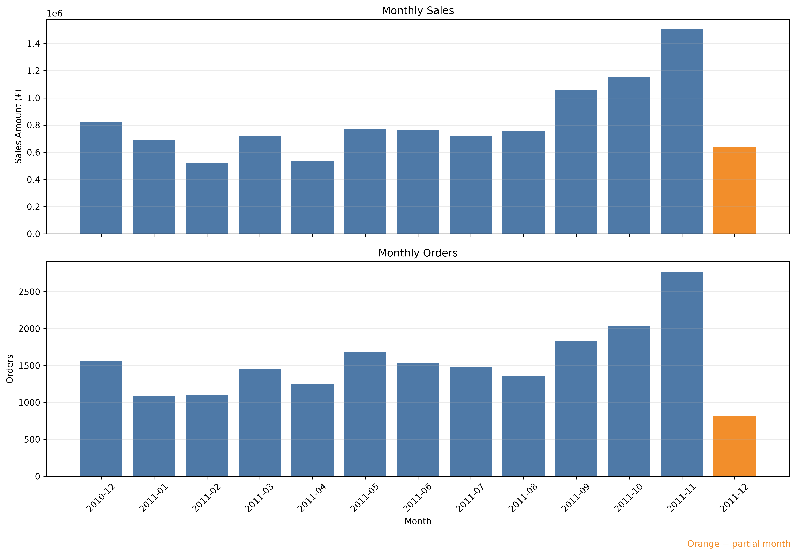
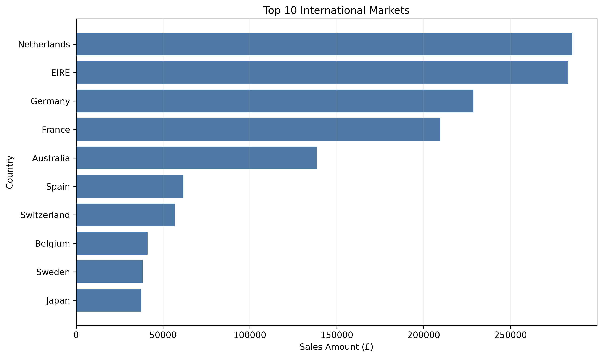
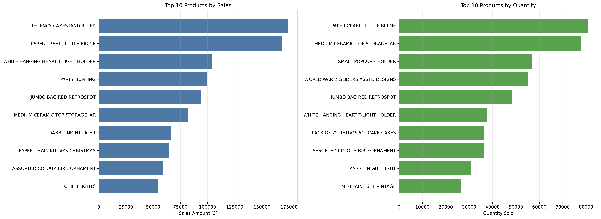
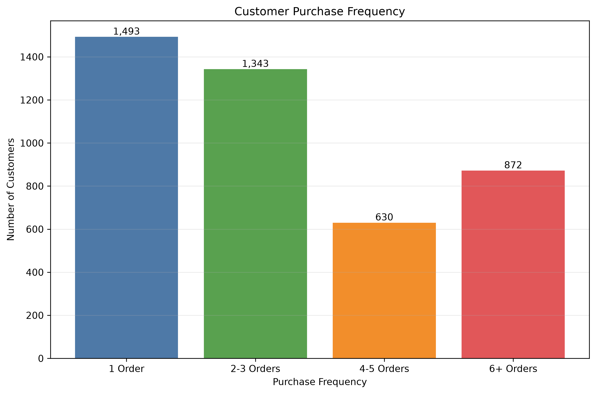
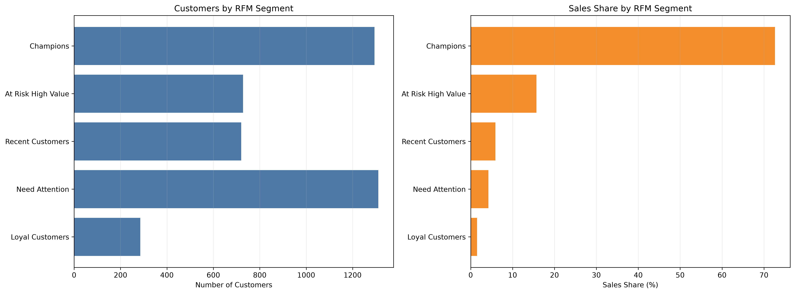
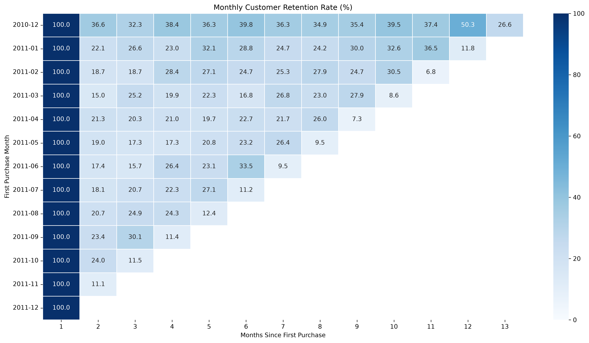

# 电商销售与客户留存分析

## 项目背景

本项目分析一家英国线上零售公司的交易数据。
数据覆盖2010年12月至2011年12月，包含约54万行商品交易明细。

项目目标是把原始订单数据转换成销售、商品、市场和客户方面的业务洞察。

## 业务问题

1. 原始数据是否存在缺失、重复和异常记录？
2. 整体销售额、订单量和平均客单价是多少？
3. 销售额随月份如何变化？
4. 哪些国家和商品贡献最多销售额？
5. 客户整体复购率是多少？
6. 哪些客户属于高价值或流失风险客户？
7. 客户首次购买后的月度留存表现如何？

## 数据来源

[UCI Online Retail Dataset](https://archive.ics.uci.edu/dataset/352/online+retail)

## 使用工具

- Python
- Pandas
- Matplotlib
- Seaborn
- IDLE
- CSV

## 分析流程

```text
理解业务问题
    ↓
检查缺失、重复、取消订单与异常值
    ↓
建立正常销售、客户分析和取消退货数据集
    ↓
计算销售核心指标
    ↓
分析月份、国家与商品表现
    ↓
计算客户复购率并进行 RFM 分层
    ↓
进行月度 Cohort 留存分析
    ↓
生成图表、结论与业务建议
```

## 数据口径

- 一行数据代表一张订单中的一种商品，不等于一张完整订单。
- 订单数量使用 `InvoiceNo` 的不重复数量计算。
- 正常销售要求订单不是取消订单、`Quantity > 0`、`UnitPrice > 0` 且日期有效。
- 缺少 `CustomerID` 的有效交易可以参与整体销售分析，但不能参与复购、RFM 和留存分析。
- 取消与退货记录单独保留，不计入正常销售额。

## 项目结构

```text
电商销售分析/
├── 代码/                  # 按执行顺序编号的 Python 脚本
├── 数据/
│   ├── 原始数据/          # 原始数据下载说明
│   └── 处理后数据/        # 汇总结果；大型明细由脚本生成
├── 图表/                  # 分析图表
├── 报告/                  # 项目总结
├── README.md
└── requirements.txt
```

## 如何复现

1. 从 [UCI Online Retail Dataset](https://archive.ics.uci.edu/dataset/352/online+retail) 下载 `Online Retail.xlsx`。
2. 将文件放入 `数据/原始数据/`。
3. 在项目目录创建并激活虚拟环境，然后安装依赖：

   ```bash
   python3 -m venv .venv
   source .venv/bin/activate
   python3 -m pip install -r requirements.txt
   ```

4. 按文件名前的编号依次运行 `代码/01_数据探索.py` 至 `代码/09_生成项目说明.py`。

大型交易明细没有提交到仓库，可通过运行清洗脚本重新生成。

## 核心销售指标

| 指标 | 结果 |
|---|---:|
| 正常销售额 | £10,642,110.80 |
| 正常订单数量 | 19,960 |
| 可识别客户数量 | 4,338 |
| 商品销售数量 | 5,572,420 |
| 平均客单价 | £533.17 |
| 平均每单商品数 | 279.18 |

## 月度销售表现

销售额最高的完整月份是 **2011-11**，销售额为 **£1,503,866.78**。

数据最后一个月不完整，因此没有直接参与完整月份比较。



## 国家市场表现

英国贡献了整体销售额的 **84.59%**。

最大的海外市场是 **Netherlands**，销售额为 **£285,446.34**。



## 商品表现

销售额最高的实际商品是 **REGENCY CAKESTAND 3 TIER**，销售额为 **£174,156.54**。

销量最高的实际商品是 **PAPER CRAFT , LITTLE BIRDIE**，销量为 **80,995件**。



## 客户复购表现

共有 **2,845位** 客户购买了两次及以上，整体复购率为 **65.58%**。



## RFM客户分层

销售贡献最高的客户群体是 **冠军客户**。

该群体客户占比为 **29.83%**，销售额占比为 **72.63%**。



## 客户留存

留存热力图展示不同首次购买月份的客户，在后续月份继续购买的比例。

右下方空白区域表示没有足够观察时间，不代表留存率为0。



## 完整项目总结

电商销售与客户留存分析项目总结
================================

一、项目背景
本项目分析一家英国线上零售公司的交易数据。
数据覆盖2010年12月至2011年12月，
目标是将原始交易明细转换为销售、客户和留存方面的业务洞察。

二、整体销售表现
正常销售额：£10,642,110.80
正常订单数量：19,960
可识别客户数量：4,338
商品销售数量：5,572,420
平均客单价：£533.17
平均每单商品数：279.18

三、月度销售表现
销售额最高的完整月份是2011-11，
当月销售额为£1,503,866.78。

数据最后一个月不完整，
因此没有直接参与完整月份之间的表现比较。

四、国家市场表现
英国贡献了整体销售额的84.59%，
说明公司销售高度集中于本土市场。

英国以外最大的市场是Netherlands，
销售额为£285,446.34。

五、商品表现
销售额最高的实际商品是：
REGENCY CAKESTAND 3 TIER
销售额为£174,156.54。

销量最高的实际商品是：
PAPER CRAFT , LITTLE BIRDIE
销量为80,995件。

销量最高与销售额最高的商品不一定相同，
因为商品价格和销售数量会共同影响销售额。

六、客户复购表现
可识别客户总数：4,338
一次性客户：1,493
复购客户：2,845
整体复购率：65.58%

复购率说明客户在整个观察期内是否再次购买，
但仍然需要结合留存分析判断客户在不同月份的持续活跃情况。

七、RFM客户分层
销售贡献最高的客户群体是：
冠军客户

该群体客户占比为29.83%，
销售额占比为72.63%。

这说明不同客户群体对销售额的贡献并不均衡，
企业应该针对不同客户群体采取不同运营策略。

八、客户留存
各客户群组第2月留存率的中位数约为：
19.86%

这说明首次购买并不等于形成稳定客户关系。
企业应重点关注首次购买后的第二次转化。

九、业务建议
1. 优先维护英国核心市场和高价值客户。
2. 重点研究表现较好的海外市场。
3. 对高销量和高销售额商品分别制定库存与推广策略。
4. 对一次性客户设计第二次购买激励。
5. 对高价值流失风险客户进行个性化召回。
6. 为冠军客户和忠诚客户提供会员权益。
7. 持续监测取消订单、异常数量和零价格交易。
8. 月度报告必须标明不完整月份。

十、项目限制
1. 数据没有商品成本，无法计算利润。
2. 数据没有营销渠道，无法进行渠道归因。
3. 部分交易缺少客户编号，无法用于客户行为分析。
4. 数据最后一个月不完整。
5. 正常销售额不完全等同于财务口径的净收入。

## 项目限制

- 数据没有商品成本，不能计算利润。
- 数据没有营销渠道，不能进行渠道归因。
- 部分交易缺少客户编号。
- 数据最后一个月不完整。
- RFM是历史行为分层，不是未来购买预测。